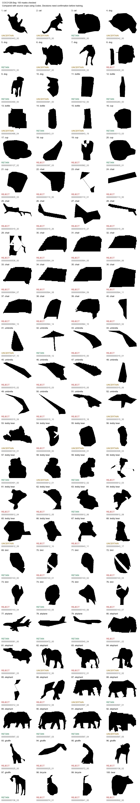

# Checking the masks

The automatic filters left 426 candidate masks. This check covers 100 of them across 13 categories, including all 40 from the earlier five-category check. Each mask was compared with its source-photo crop using Codex. These are AI-assisted decisions and need human confirmation before training.

| Category | Retain | Reject | Unsure | Total checked |
| --- | --- | --- | --- | --- |
| Cat | 1 | 0 | 2 | 3 |
| Dog | 2 | 1 | 4 | 7 |
| Bottle | 3 | 0 | 2 | 5 |
| Cup | 3 | 3 | 0 | 6 |
| Chair | 0 | 19 | 0 | 19 |
| Umbrella | 1 | 8 | 3 | 12 |
| Teddy bear | 3 | 7 | 6 | 16 |
| Bird | 3 | 5 | 0 | 8 |
| Airplane | 3 | 0 | 0 | 3 |
| Elephant | 4 | 5 | 4 | 13 |
| Giraffe | 1 | 4 | 0 | 5 |
| Bicycle | 0 | 2 | 0 | 2 |
| Bear | 0 | 1 | 0 | 1 |
| **Total** | **24** | **55** | **21** | **100** |

Retained masks had no obvious major occlusion in this check. Rejected masks had incomplete outlines, usually because another object was in front. Uncertain cases need a closer look, often because the source is small or the boundary is hard to follow. The original category labels were kept.

The clearest problem was already-hidden objects. A dog behind a car window passed the automatic size and image-edge checks, even though most of its body was missing. Many chair masks contained only a backrest. Complete outlines also vary with pose: the lying dog was retained rather than rejected for looking different from a standing dog.

Small bottles raised a different issue. Their polygon outlines can be too coarse to judge confidently. Cup handles also showed why converted polygon labels need care: the outer silhouette may look usable while a handle hole has been lost. No holes were filled or contours repaired here.

The 13 categories were chosen for inspection, not as the final project classes. Every automatically screened candidate in these categories was checked, in category order and then source-ID order. Several chairs, birds, and bears share photographs, so these counts are not COCO-wide acceptance rates. A few labels refer to toys or models, such as a giraffe model; those will need a consistent inclusion rule when choosing the final classes.

The numbered sheets show all 100 decisions: [1–20](mask_review_page_1.png), [21–40](mask_review_page_2.png), [41–60](mask_review_page_3.png), [61–80](mask_review_page_4.png), and [81–100](mask_review_page_5.png).



## Files and rerunning

`mask_review.csv` records the reason for each decision. Instance IDs combine the source-image ID with the zero-based line number in its polygon-label file. `review_summary.json` contains the counts generated from those records.

After running the pilot, generate the comparison sheets with:

```sh
python build_review_sheet.py --data-dir /path/to/coco128-seg
```

Ten source-photo comparison sheets are saved under `output/silhouette_pilot/`; they stay local. The script also regenerates the mask-only images and summary counts above. Use `--sources-only` to inspect the source sheets before adding or revising CSV decisions.

Data: [Ultralytics COCO128-Seg](https://docs.ultralytics.com/datasets/segment/coco128-seg/), derived from [COCO](https://cocodataset.org/). This check uses converted polygon labels. The planned full dataset will use COCO 2017 instance annotations.
